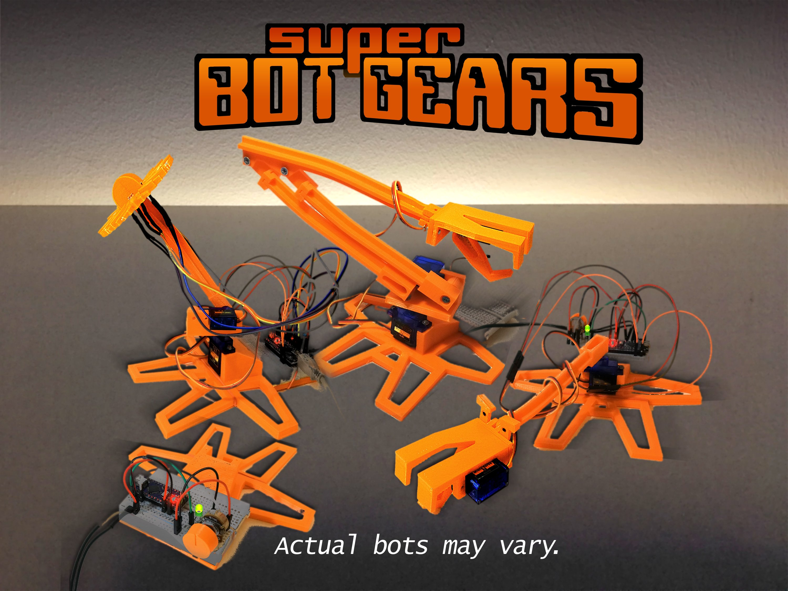

# Super Bot Gears

A 5-in-1 educational, 3D-printed Arduino starter kit.

This is an educational Arduino set I've prepared for my nieces to teach them about electronics. While I was at it, I decided to also make it open source and publish it on the internet for free!

All the documents are available in English and Polish. You need a 3D printer to print all the plastic elements.

Video: [Super Bot Gears on YouTube](https://youtu.be/yBgqDcDxOuM)

## The five projects

| Project | Code | Diagram | What it does |
|---|---|---|---|
| Blink | [`BlinkSBG.ino`](code/BlinkSBG/BlinkSBG.ino) | [blink.jpg](diagrams/blink.jpg) | Blinks the LED on D13 |
| Fade | [`FadeSBG.ino`](code/FadeSBG/FadeSBG.ino) | [fade.jpg](diagrams/fade.jpg) | Sets the LED brightness with the knob (A0) |
| Power Flower | [`FlowerSBG.ino`](code/FlowerSBG/FlowerSBG.ino) | [power_flower.jpg](diagrams/power_flower.jpg) | Turns the flower towards the light using 4 photoresistors (A1–A4) and 2 servos (D9, D10) |
| Wild Dragon | [`DragonSBG.ino`](code/DragonSBG/DragonSBG.ino) | [wild_dragon.jpg](diagrams/wild_dragon.jpg) | Moves the dragon at random (servos on D9–D11); the knob (A0) sets the speed |
| Robo Arm | [`RoboArmSBG.ino`](code/RoboArmSBG/RoboArmSBG.ino) | [robo_arm.jpg](diagrams/robo_arm.jpg) | Controls the arm with the joystick (A5, A6) and the gripper with the joystick button (D2) |

## Repository contents

| Path | Contents |
|---|---|
| [`code/`](code) | Arduino code for the five projects |
| [`diagrams/`](diagrams) | Wiring diagrams |
| [`stl/`](stl) | 3D printing files (the prefix is the number of copies to print) |
| [`docs/instructions_en.pdf`](docs/instructions_en.pdf) | Assembly instructions in English (A5) |
| [`docs/instructions_pl.pdf`](docs/instructions_pl.pdf) | Assembly instructions in Polish (A5) |
| [`docs/box_label_en.jpg`](docs/box_label_en.jpg) | Box label in English (A4) |
| [`docs/box_label_pl.jpg`](docs/box_label_pl.jpg) | Box label in Polish (A4) |

## Parts (and approximate price)

- 19 3D-printed plastic elements (0–10 USD)
- 3× M3 washers (0.5 USD)
- 1× M3 14 mm bolt (0.5 USD)
- 4× M3 12 mm bolt (0.5 USD)
- 6× 8 mm bolt + 3× 4 mm bolt (sold with the servos)
- 3× SG90 mini servo (4.5 USD)
- Dupont-style jumper wires, male-male and female-male (5 USD)
- Arduino Nano compatible board (2 USD)
- 10 kΩ potentiometer (0.5 USD)
- 5× 220 Ω resistor (0.5 USD)
- 6.8–10 kΩ resistors (0.5 USD)
- 5 V LED (0.5 USD)
- 4× 10–20 kΩ photoresistor (1 USD)
- 1× HW-504 joystick (2 USD)
- 5 V power supply or a 5 V 450 mA phone charger (2 USD)
- 1× 400-point solderless breadboard (2 USD)
- 1× USB cable (1 USD)
- 1× small screwdriver (1 USD)
- Empty cardboard box, optional (0 USD)

## 3D printing

- Printer: Prusa i3 clone
- Infill: 20%
- Supports: no
- Rafts: no

The beams are printed vertically, so make sure your printer can make consistent layers, or your beams may break. The holes may need pre-drilling or sanding, depending on your printer's tolerances. Small servos always seem to differ slightly in dimensions depending on the manufacturer, so be aware of that.

## Links

- [Arduino Project Hub](https://projecthub.arduino.cc/bzqp/super-bot-gears-a-3d-printed-arduino-starter-kit-6d6613)
- [Thingiverse](https://www.thingiverse.com/thing:4176199)

## License

Super Bot Gears by bzqp is licensed under the [Creative Commons Attribution 4.0 International](https://creativecommons.org/licenses/by/4.0/) license (CC BY 4.0). See [LICENSE](LICENSE).
